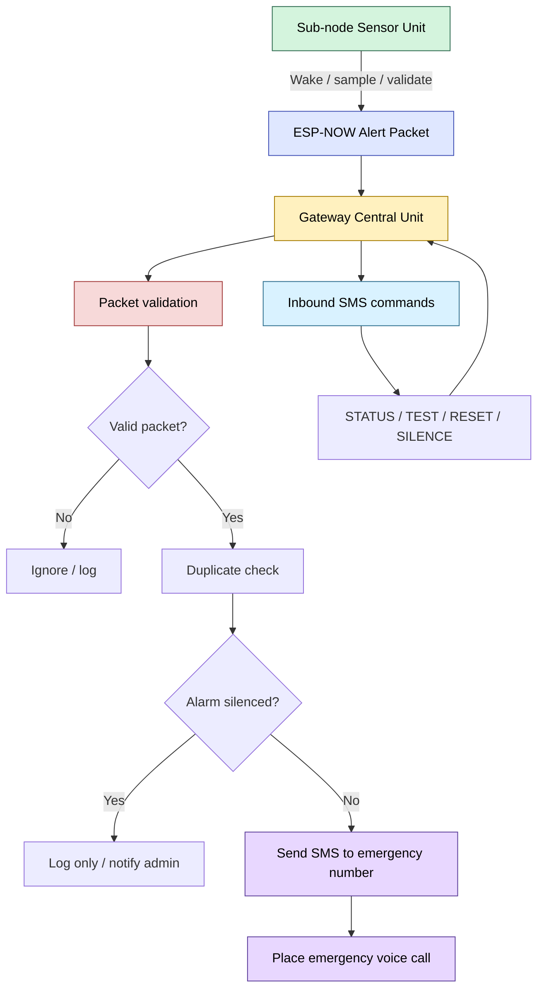
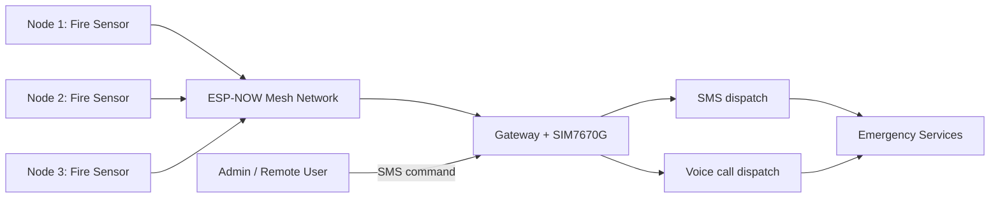

<!-- Author attribution: Sourish Raj Gubbala -->
# EmberLink Work Blueprint

## 1. System blueprint

### Role split

### Physical architecture

---

## 2. Implementation blueprint

### Phase 1: Define the contract
1. Define the shared mesh packet structure.
2. Define event types: ALERT, TEST, HEARTBEAT, STATUS, SILENCE.
3. Define the node ID, smoke value, temperature, alarm level, timestamp, and version field.
4. Ensure the gateway rejects malformed packets before any dispatch action.

Required files to anchor this:
- [shared/emberlink_types.h](../shared/emberlink_types.h)
- [shared/emberlink_shared.h](../shared/emberlink_shared.h)

### Phase 2: Build the sub-node firmware
1. Start in deep sleep.
2. Wake due to timer or wake trigger.
3. Read smoke value.
4. Read temperature.
5. Sanitize invalid sensor values.
6. Decide if an alarm condition is present.
7. Build a packet.
8. Broadcast packet via ESP-NOW.
9. Sleep again.

Implementation files:
- [subnode/subnode_main.cpp](../subnode/subnode_main.cpp)
- [subnode/sensors.cpp](../subnode/sensors.cpp)
- [subnode/power.cpp](../subnode/power.cpp)

### Phase 3: Build the gateway firmware
1. Start Wi-Fi in AP mode.
2. Initialize ESP-NOW.
3. Register receive callback.
4. Validate every incoming packet.
5. Suppress duplicate alerts for a cooldown period.
6. Check silence flag before dispatch.
7. Send emergency SMS.
8. Attempt emergency voice call.
9. Keep modem ready and stable for inbound SMS control.

Implementation file:
- [gateway/gateway_main.cpp](../gateway/gateway_main.cpp)

### Phase 4: Add modem command handling
1. Configure SIM7670G in SMS mode.
2. Parse incoming SMS commands.
3. Support STATUS, TEST, RESET, and SILENCE.
4. Respond with acknowledgement SMS.
5. Keep reverse communication working from user to gateway.

### Phase 5: Add safety and resilience
1. Validate packet integrity before dispatch.
2. Rate-limit duplicate dispatch.
3. Fail gracefully if modem is unavailable.
4. Use tolerant fallback rather than brittle fail-fast logic.
5. Keep silent mode available for maintenance or false alarm suppression.

### Phase 6: Validation gate
1. Run host-side logic validation.
2. Confirm sensor readings are sanitized.
3. Confirm ESP-NOW packet contract is valid.
4. Confirm gateway can handle test and alarm events.
5. Confirm system only dispatches valid emergency events.

Validation reference:
- [phase5_verify.ps1](../phase5_verify.ps1)
- [memory_bank/phase5_verification.md](../memory_bank/phase5_verification.md)

### Phase 7: Real hardware proof
1. Flash sub-node firmware onto a sensor ESP32.
2. Flash gateway firmware onto the central control ESP32.
3. Connect the SIM7670G modem to UART2.
4. Validate modem boot and SMS mode.
5. Trigger a test packet from the node.
6. Confirm gateway receives the packet.
7. Confirm SMS is sent.
8. Confirm voice call is placed.
9. Confirm SMS commands work in reverse.
10. Confirm full alarm chain works in a real environment.

Hardware validation reference:
- [memory_bank/phase6_hardware_validation.md](../memory_bank/phase6_hardware_validation.md)

---

## 3. Step-by-step work sequence

### Step A: Gather baseline
- Confirm the legacy prototype remains a reference only.
- Do not mix legacy code into the active architecture.
- Stick to the split firmware model.

### Step B: Freeze shared packet contract
- Build the packet schema in shared files.
- Lock the event types and validation rules.
- Ensure all nodes agree on the format.

### Step C: Complete sub-node runtime
- Deep-sleep wake cycle
- sensor reads
- value validation
- alarm decision
- packet transmit
- sleep again

### Step D: Complete gateway receive logic
- Wi-Fi AP and ESP-NOW init
- receive callback
- packet validation
- duplicate suppression
- state flags

### Step E: Complete gateway dispatch logic
- SMS send
- voice call
- alarm silence logic
- admin notification fallback

### Step F: Add command interface
- STATUS
- TEST
- RESET
- SILENCE

### Step G: Validate locally
- Host-side compile and logic validation
- confirm no regression in packet validation and alarm logic

### Step H: Move to hardware proof
- bench test real ESP32 boards
- validate final alarm path in hardware

### Step I: Field rollout
- deploy sub-nodes to fire-risk locations
- position the gateway at the central control point
- test the actual emergency chain under realistic conditions

---

## 4. Expected final system behavior

When the final system is working correctly:
- the sensor node wakes and samples
- it detects dangerous smoke or temperature conditions
- it sends a trusted packet over ESP-NOW
- the gateway receives the packet
- the gateway validates it
- the gateway sends emergency SMS and voice alert
- the operator can send back commands over SMS to query or control the gateway

This is the complete operational model of EmberLink.

---

## 5. Build checklist

### Sub-node
- [ ] deep sleep works
- [ ] smoke and temperature readings are valid
- [ ] invalid readings are rejected
- [ ] alarm condition is evaluated correctly
- [ ] ESP-NOW alert packet is transmitted
- [ ] self-test packet works

### Gateway
- [ ] Wi-Fi AP mode starts
- [ ] ESP-NOW receive callback works
- [ ] bad packets are ignored
- [ ] duplicates are suppressed
- [ ] emergency SMS is sent
- [ ] voice call is attempted
- [ ] admin SMS commands work
- [ ] silence mode blocks dispatches correctly

### Full system
- [ ] node-to-gateway alert works
- [ ] gateway dispatch works
- [ ] reverse SMS control works
- [ ] true hardware proof is complete

---

## 6. Implementation mindset

The system should be built in this order:

1. shared contract
2. sub-node sensing
3. gateway receive
4. gateway dispatch
5. reverse SMS control
6. validation
7. hardware proof
8. deployment

Do not move to deployment before the hardware validation step is passed.
